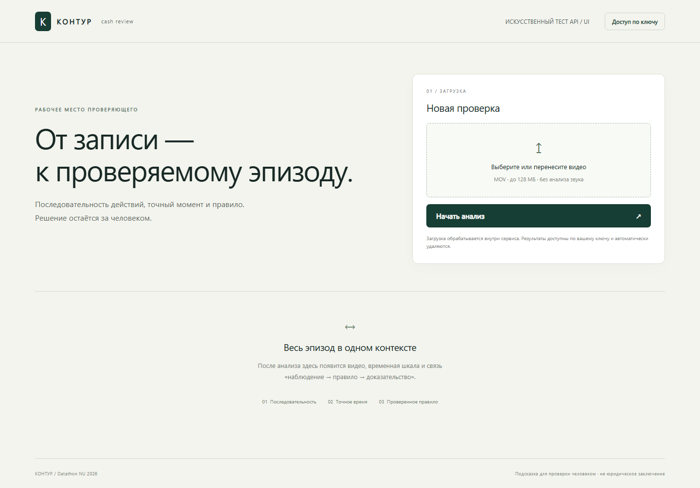

# Контур

**Experimental prototype.** Frontend и API работают. Единственный актуальный вход: [UI / API](https://sword-fire-sim-conversion.trycloudflare.com). Отдельный временный ключ жюри доступен только в локальном окне; expiry — **18 октября 2026, 18:59:59 UTC / 23:59:59 Астаны**. [Получение ключа, отзыв, перезапуск и комплект сдачи](docs/final-handoff.md).

**Качество детектора:** сохранённая оценка TUNE — **TP 1 / FN 4 / FP 3 / TN 1; F1 = 0.222222…**. Типизация действий и применимость правил неподтверждены. Это частичный экспериментальный контракт; успешные software/synthetic тесты не являются accuracy модели. Новых запросов к TUNE/HOLDOUT не было.

**От записи — к проверяемому эпизоду.** Локальное рабочее место для проверки визуальных признаков возможных нарушений кассовой дисциплины.

Команда **TerenOi** · Datathon NU 2026 · кейс ForteBank

[Приватный репозиторий исходного кода](https://github.com/seoshiro/forte-cash-review) · доступ по правам GitHub

Проверяющий может перейти к предложенному моменту, посмотреть контекст до и после и исходные candidate-кадры. Бинарная модель предлагает кандидат; его действие, тип и применимое правило не установлены. Решение остаётся за человеком.

> **Исследовательский прототип.** Загрузка, фоновые задания, интерфейс и API-контракт проверены на искусственных MOV. Есть локальная экспериментальная бинарная модель XCLIP и временный защищённый публичный доступ. Отдельный partial-v1 профиль возвращает реальные бинарные результаты и таймкоды в обязательной JSON-схеме с явным неустановленным типом. Принятого классификатора типов и применимости правил пока нет. Независимое качество и готовность к конкурсной проверке не подтверждены. [Режимы, ограничения и срок доступа](docs/partial-v1-contract.md).

[Запуск](#быстрый-запуск) · [Архитектура](#архитектура) · [API](#api) · [Измерения](#измерения) · [Ограничения](#ограничения) · [Лицензии](#лицензии)

*Работающий пустой интерфейс в synthetic-test режиме. Нет выбранного видео, ключа, задания или результата. Это вид продукта, а не демонстрация качества обнаружения. [Происхождение скриншота](docs/assets/README.md).*

## Сценарий проверки

1. Загрузить MOV и следить за обработкой.
2. Открыть готовый результат и выбрать событие на временной шкале.
3. Сопоставить позицию в видео, контекст и карточку «наблюдение → правило → доказательство».
4. Проверить ограничения. Заметки проверяющего сохраняются отдельно от исходного автоматического результата.

Этот интерфейсный сценарий проверен на **сценарных искусственных данных**. Бинарный research API отделён от конкурсного контракта: прогноз не выдаётся за установленный тип нарушения или юридическое основание.

Продуктовая гипотеза — ускорить ручную проверку благодаря контексту эпизода и переходу к кадру. Ускорение работы человека ещё не измерено. Преимущество coarse/refine перед равномерным анализом также не подтверждено.

## Быстрый запуск

На подготовленном Windows, в PowerShell из корня существующего репозитория:

~~~powershell
$env:CASH_API_KEY='temporary-local-demo-only'
$env:CASH_PRIVATE=Join-Path $PWD '.private/demo-jobs'
& .\scripts\start.ps1 -SyntheticTest -Port 8792
~~~

Откройте **http://127.0.0.1:8792/**. В диалоге доступа введите тестовое значение из команды. Выберите созданный при запуске файл **.private/synthetic/safe.mov** или **positive.mov** и начните проверку.

Этот режим принимает только точные сгенерированные fixtures. Результаты заданы сценарием для проверки механики; банковские и тестовые видео жюри в него загружать нельзя. Остановка — **Ctrl+C** в терминале. Параметры действуют только в текущем процессе. При занятом порте выберите другой; защита ОС и firewall не меняются. [Проверенный runbook](docs/local-demo-runbook.md).

### Окружение

Рабочая среда — **Python 3.12.11**, папка **.venv-patched**, [точный lock зависимостей](requirements-patched-lock.txt). Стек: PyTorch CUDA, Transformers, FastAPI, PyAV, локальные HTML/CSS/JS. PyAV поставляет нативные FFmpeg-библиотеки; отдельный CLI FFmpeg для этого запуска не требуется. Synthetic demo не загружает нейросеть.

Восстановление окружения на новой Windows-машине с совместимым NVIDIA-драйвером:

~~~powershell
py -3.12 -m venv .venv-patched
.\.venv-patched\Scripts\python.exe -m pip install --index-url https://download.pytorch.org/whl/cu130 'torch==2.14.1+cu130' 'torchvision==0.29.1+cu130'
.\.venv-patched\Scripts\python.exe -m pip install -r requirements-patched-lock.txt
~~~

Lock описывает фактически установленную среду. **Чистая установка на другой машине ещё не проверена.** Тяжёлые эксперименты автоматически не запускаются. Старая среда .venv сохранена для истории; текущие команды используют .venv-patched.

## Архитектура

~~~mermaid
flowchart LR
    A[Локальный браузер или API-клиент] --> B[FastAPI: ключ и лимиты]
    B --> C[Приватное хранилище задания]
    C --> D[Отдельный ограниченный worker]
    D --> E[PyAV: PTS и поворот]
    E --> F[Локальные features / модель]
    F --> G[Проверка схемы и ограничений]
    G --> C
    C --> B
    B --> H[Статус, таймлайн, исходные JPEG]
~~~

Все вычисления выполняются внутри сервиса. Входное имя заменяется непрозрачным job ID; имя, номер файла и официальные ответы не подаются модели. Времена определяются по декодированным PTS с учётом поворота MOV. Исходный JPEG не подменяется нарисованной иллюстрацией.

API ограничивает загрузки и допускает один активный inference. Перегрузка отклоняется вместо скрытого ожидания в очереди. Бюджет включает загрузку и обработку; зависший worker останавливается вместе с принадлежащими ему дочерними процессами. Результаты привязаны к владельцу ключа и удаляются по политике хранения. Технический сбой — **failed**, а не отсутствие нарушения.

Нормативные ссылки берутся из локального реестра с условиями применимости. Наличие реестра ещё не доказывает, что модель установила эти условия на видео.

## API

Конкурсный контракт реализован и проверен в synthetic-test режиме:

| Метод | Путь | Результат |
|---|---|---|
| POST | /api/v1/analyze | Multipart-поле **file**, MOV → job_id |
| GET | /api/v1/jobs/{job_id} | processing, done или failed |

Оба метода требуют **X-API-Key**. Отсутствующий и неверный ключ отклоняются. Неизвестное или чужое задание не раскрывает результат. Ключ хранится на сервере, не зашит в JS или репозиторий.

В другом PowerShell-окне, пока работает synthetic demo:

~~~powershell
$taskBase='http://127.0.0.1:8792'
$taskKey='temporary-local-demo-only'
curl.exe -X POST "$taskBase/api/v1/analyze" -H "X-API-Key: $taskKey" -F 'file=@.private/synthetic/safe.mov'
curl.exe "$taskBase/api/v1/jobs/JOB_ID_FROM_POST" -H "X-API-Key: $taskKey"
~~~

Замените **JOB_ID_FROM_POST** ответом первого запроса и опрашивайте до конечного статуса. При **done** допустимы только **violation** и **no_violation**. Для первого violations содержит тип, секунду, описание и 1–3 JPEG в обычном base64; для второго список пустой. Ссылка на правило может входить в description. [Контракт и проверки](docs/competition-contract.md).

**Бинарный research API:** /api/experimental/xclip/analyze и /api/experimental/xclip/jobs/{job_id}. Хранилище отдельное; тип **unverified**, правило **not_assessed**. В базовом режиме /api/v1/* возвращает 503. Сам движок выполняется локально и требует приватного TRAIN-пакета, которого нет в чистом клоне. [Подготовка и запуск](docs/xclip-experimental-api.md).

**Новый opt-in partial-v1 профиль:** отдельный защищённый публичный origin возвращает реальные бинарные результаты baseline, таймкоды и исходные candidate JPEG через /api/v1/*. Тип явно не классифицирован; применимая норма не установлена. Это частичный экспериментальный контракт. [Проверка, ограничения и доступ](docs/partial-v1-contract.md).

## Измерения

Основной результат — **exploratory TRAIN group OOF**, не независимая оценка и не балл жюри. В сравнении 26 уникальных видео в 24 автоматических группах. Видео и соседние окна одной группы не делятся между folds. TRAIN повторно используется в исследованиях, группы не проверены экспертом. Отдельная однократная оценка неизменённого cosine baseline на TUNE показала слабое качество; параметры после неё не менялись. HOLDOUT закрыт.

| Проверка | Результат | Условия и смысл |
|---|---|---|
| XCLIP cosine ordered-max | TN 6 · FP 6 · FN 2 · TP 12; precision 0.666667; recall 0.857143; F1 0.75 | Reused TRAIN; исходный release gate не пройден |
| Тот же cosine baseline на TUNE | TN 1 · FP 3 · FN 4 · TP 1; F1 0.222222 | Одна frozen оценка: 9 исходных роликов, 8 уникальных содержимых; не финальный тест |
| TUNE: время и кандидатная точка | Median 29.938 с; p95 41.4782 с; max 42.547 с; MAE точки 3.0 с при n=1 TP | Полный локальный cold worker, без HTTP upload; типы, правила и релевантность кадров не валидированы |
| XCLIP fixed logistic head | TN 4 · FP 8 · FN 4 · TP 10; F1 0.625 | Один frozen TRAIN group-CV опыт на том же кэше; ухудшение, кандидат отклонён |
| XCLIP temporal head, 209 параметров | TN 12 · FP 0 · FN 14 · TP 0; F1 0 | Один frozen post-TUNE TRAIN group-CV опыт; все решения отрицательные, кандидат отклонён |
| Время кандидата XCLIP | MAE 8.833333 с на 12 true-positive видео | Единственная официальная точка; не границы события или релевантность JPEG |
| Actual-model XCLIP API | 22.375 и 18.360 с от загрузки до результата | Два искусственных MOV-запроса; не SLA и не качество на банковских видео |
| InternVL3.5-1B visual control | 3/6 верных последовательностей, 1/2 UNKNOWN без изображения | Gate не пройден; TRAIN не запускался |
| Ресурсы InternVL control | Пик устройства 2367 МиБ; минимум доступной RAM 2.334 ГиБ; monitor 57.203 с | Только 4 искусственных кадра/blank; не fit реального видео |
| Синтетический внешний HTTPS | 2 задания, 3 исходных JPEG проверены; auth/изоляция/rollback PASS | Искусственные MOV, задержка 10 с; туннель и сервер остановлены; не качество модели |
| Текущий checkpoint | 438 тестов passed, без failures/errors/skips | Source/synthetic проверки; не точность детектора; см. docs/final-handoff.md |

Расчёты: [XCLIP](docs/xclip-candidate.md), [logistic head и paired point diagnostics](docs/xclip-linear-head.md), [research API](docs/xclip-experimental-api.md), [InternVL](docs/internvl-visual-control.md), [TUNE](docs/xclip-tune.md), [temporal learning](docs/xclip-temporal-head.md), [аудит подготовки](docs/train-preparation-audit.md), [claim ledger](docs/claim-ledger-index.md). Logistic head уменьшил MAE кандидатной точки с 9 до 8.928571 с на тех же 14 positive видео, но увеличил FN/FP; это не принято как преимущество. Полный cache-only CPU процесс занял 3.75 с, без декодирования и encoder inference. Неудачные опыты сохраняются; параметры после результата не подбираются.

## Ограничения

- Принятого классификатора действий, типов и применимости норм нет. Несколько событий и новые типы надёжно не валидированы.
- Единственная точка разметки не описывает все события и границы. Качество доказательств требует отдельной локальной проверки человеком.
- Другой реальный ракурс не проверен. Поворот, crop и яркость не заменяют новую камеру.
- Полный лимит обработки реальных новых загрузок, включая самый длинный вход, не подтверждён.
- Worker ограничивает сетевые обращения и использует заранее загруженные веса. Физическая автономность при отключённом интернете отдельно не подтверждена.
- Синтетический публичный HTTPS проверен и остановлен. Работающего адреса конкурсного сервиса, постоянного ключа жюри и подтверждения приёма пока нет. Форма не отправлена.

[TUNE checkpoint](docs/xclip-tune.md), [доступ и rollback](docs/external-access-preflight.md), [фактические возможности правил](docs/semantic-capability-inventory.md), [текущий checkpoint](docs/current-checkpoint.md) и [матрица критериев](docs/submission-criteria-matrix.md) отделяют работающую механику от незакрытого качества.

## Защита данных

Банковские видео, кадры, описания эпизодов, разметка, аннотации, per-video predictions и результаты остаются локально. Их нельзя открывать облачными vision/browser/capture-инструментами или отправлять облачным AI API. **Аудио, распознавание и идентификация лиц не используются.** Исходные данные не меняются и не переименовываются.

Приватные папки, модели, среды, кэши, медиа, таблицы, результаты и секреты исключены из Git. Единственное разрешённое изображение — пустой UI выше: точные путь, размер и SHA256 закреплены в release gate. Любое другое изображение или изменение его байтов блокируется.

UI использует локальные ресурсы без CDN и аналитики. API не открывает каталог данных и незащищённые кадры. Разрешённая синтетическая HTTPS-проверка выполнена в отдельном экземпляре и завершена остановкой собственных процессов. Demo-ключи хранятся локально под DPAPI USER; постоянный ключ жюри ещё не создан. Тестовое значение не подходит для жюри. Платные функции запрещены. Исходный код загружается только в приватный GitHub после аудита рабочего дерева и всей истории; банковские данные и ключи исключены.

## Проверки и устройство репозитория

~~~powershell
.\.venv-patched\Scripts\python.exe -m pytest tests -q --basetemp=.private/tests-readme
.\.venv-patched\Scripts\python.exe scripts/audit_repo.py
.\.venv-patched\Scripts\python.exe scripts/audit_git_history.py
git status --short
~~~

Тесты используют искусственные inputs и лёгкие процессы, не открывают банковские видео/модели. API-тестам нужен разрешённый loopback-контекст. При ограничении песочницы не менять защиту ОС. Аудит проверяет рабочее дерево, reachable Git history, запрещённые типы и известные маркеры секретов. Это не универсальное доказательство отсутствия закодированного секрета; нужен source review.

| Путь | Назначение |
|---|---|
| cashreview/ | API, worker, изоляция, PTS, строгие схемы |
| static/ | Локальный интерфейс |
| xclip_candidate/ | Frozen features и бинарные research эксперименты |
| config/ | Протоколы и пины артефактов |
| config/rules.json | Источники и условия применимости |
| tests/ | Synthetic unit/integration проверки |
| docs/ | Измерения, ограничения, лицензии и материалы сдачи |

## Лицензии

| Компонент | Код | Веса / статус |
|---|---|---|
| Собственный код | [Apache-2.0](LICENSE) | Данные конкурса и outputs лицензией кода не покрываются |
| Microsoft XCLIP | MIT upstream; Apache-2.0 native Transformers | MIT; пины ревизии/SHA256, в Git отсутствуют |
| InternVL3.5-1B-HF | Apache-2.0 native Transformers, без remote code | Apache-2.0; исследовательский кандидат отклонён |
| Qwen3-VL / DINOv2 | Apache-2.0 | Apache-2.0; исследовательские ветки, не принятые детекторы |

Код и веса проверяются отдельно; attribution сохраняется. Нативные FFmpeg-библиотеки и CUDA имеют отдельные условия. PyAV wheel не объявляется permissive-only и не перепаковывается здесь. [Проверенная связь нормативных источников](docs/legal-source-provenance.md), [полный реестр лицензий](docs/licenses.md), [XCLIP provenance](docs/xclip-candidate.md), [InternVL provenance](docs/internvl-visual-control.md).

Для команды **TerenOi** подготовлены [комплект сдачи](docs/submission.md), [локальное демо](docs/local-demo-runbook.md) и [порядок внешнего доступа](docs/external-access-preflight.md). README не отправляет заявку и не подтверждает готовность сервиса.
